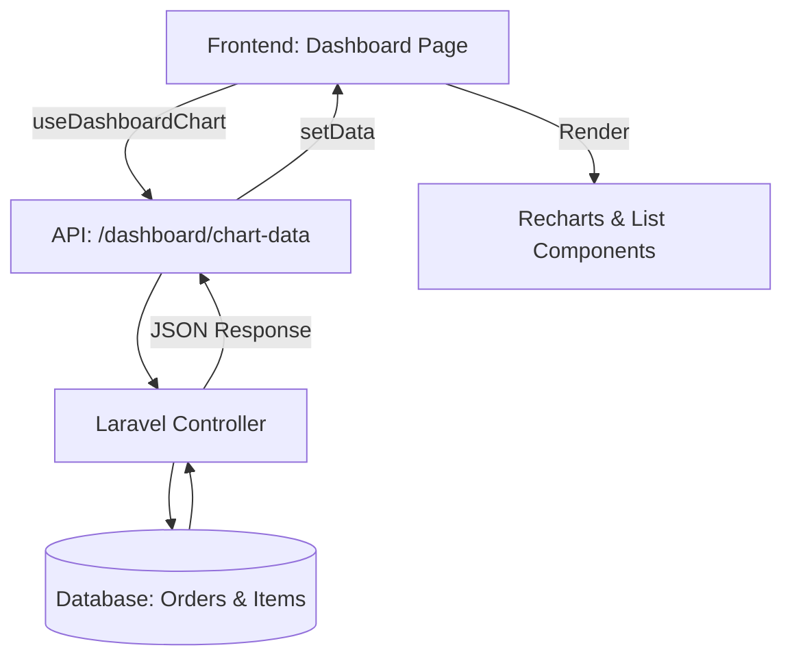

# Dokumentasi Fitur Analytics Dashboard POS

Fitur ini menyediakan visualisasi data transaksi secara real-time untuk membantu pemilik usaha menganalisis performa penjualan, tren pendapatan, metode pembayaran, dan produk terlaris.

## 1. Arsitektur Data Alur



---

## 2. Logika Backend (Laravel)

### Endpoint Utama
`GET /dashboard/chart-data`

### Parameter Request
| Param | Deskripsi | Default |
|-------|-----------|---------|
| `period` | Granularitas data (`daily`, `weekly`, `monthly`, `yearly`) | `daily` |
| `date` | Tanggal acuan untuk periode standar | `today` |
| `from` | Tanggal mulai (Kustom) | - |
| `to` | Tanggal akhir (Kustom) | - |

### Penentuan Range Waktu (Carbon)
Sistem menggunakan library Carbon untuk menentukan `$start` dan `$end` berdasarkan parameter. Jika `from` & `to` diisi, sistem beralih ke mode `custom`.

```php
if ($fromDate && $toDate) {
    $start = Carbon::parse($fromDate)->startOfDay();
    $end = Carbon::parse($toDate)->endOfDay();
    $period = 'custom';
}
```

### Aggregasi Data
1.  **Trend Data:** Mengelompokkan transaksi berdasarkan jam (daily), hari (weekly/monthly/custom), atau bulan (yearly). Menggunakan `SUM(grand_total)` dan `COUNT(*)`.
2.  **Payment Distribution:** Menghitung total volume dan frekuensi penggunaan per `payment_method`.
3.  **Top Selling Items:** Melakukan *Join* antara tabel `orders`, `order_items`, dan `items` untuk menemukan produk dengan `SUM(quantity)` tertinggi dalam rentang waktu yang dipilih.

### Logika "Gap Filling" (`fillTimeSlots`)
Untuk mencegah grafik "bolong" (misal: jam 14:00 tidak ada transaksi), backend men-generate array kosong untuk seluruh slot waktu dalam periode tersebut dan mengisi datanya hanya jika tersedia di hasil query database.

---

## 3. Logika Frontend (React + TypeScript)

### Custom Hook: `useDashboardChart`
Hook ini bertanggung jawab untuk:
*   Mengelola state `period`, `date`, dan `dateRange`.
*   Melakukan fetch data secara otomatis setiap kali filter berubah.
*   Menyediakan fungsi `refetch` untuk pembaruan manual.

### Komponen Visualisasi
1.  **RevenueTrendChart (ComposedChart):**
    *   `AreaChart` (Sumbu Y Kiri): Menampilkan tren Pendapatan (IDR).
    *   `BarChart` (Sumbu Y Kanan): Menampilkan frekuensi Pesanan (Trx).
2.  **PaymentDistributionChart (Pie/Donut):**
    *   Menampilkan porsi penggunaan Cash vs Transfer.
    *   Menangani status **"Empty"** jika tidak ada data transaksi agar UI tidak terlihat rusak.
3.  **TopItemsList:**
    *   Menampilkan 5 produk terlaris.
    *   Menampilkan thumbnail produk menggunakan `storage` asset Laravel.

---

## 4. Optimasi Performa

### Database Indexing
Query analytics bisa menjadi sangat berat seiring bertambahnya data. Kita telah menambahkan **Composite Indexes** pada tabel `orders`:
*   `idx_orders_status_created`: Mempercepat filter berdasarkan status (exclude cancel) dan range tanggal.
*   `idx_orders_payment_created`: Mempercepat perhitungan distribusi pembayaran.

### Skalabilitas
Untuk data di atas 1 Juta baris, dokumentasi ini merekomendasikan:
1.  **Caching:** Menggunakan Redis untuk menyimpan response API selama 5-10 menit.
2.  **Summary Table:** Membuat tabel agregasi harian yang diisi melalui Scheduled Task (Cron Job) agar dashboard tidak langsung menghitung dari tabel transaksi mentah.

---

## 5. Struktur File Baru

| File | Peran |
|------|-------|
| `DashboardController.php` | Handler logika aggregasi & API |
| `use-dashboard-chart.ts` | Data fetching & state management |
| `revenue-trend-chart.tsx` | Visualisasi tren pendapatan |
| `payment-distribution-chart.tsx` | Visualisasi metode pembayaran |
| `top-items-list.tsx` | List produk terlaris |
| `chart.ts` | Type definitions (TypeScript) |
